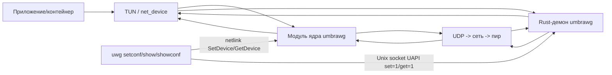

# Архитектура UmbraWG

UmbraWG — форк AmneziaWG/WireGuard: протокол Noise IK плюс обфускация 3.1
(junk-пакеты, magic-заголовки H1–H4, header protection и т. д.). Система
состоит из четырёх независимых компонентов, которые разрабатываются в
отдельных репозиториях и связываются только через стабильные форматы
(байты на проводе, netlink-атрибуты, UAPI, INI-конфиг). Этот документ —
обзор; детали — в ссылках в конце.

Пути ниже указаны относительно корня workspace (каталог, в котором лежат
репозитории `tools`, `module-master`, `rust-parallel-rx`, `netlink-packet-umbrawg`).
Если репозиторий переименован (в частности `netlink` вместо
`netlink-packet-umbrawg`), скорректируйте путь.

## 1. Компоненты и роли

| Компонент | Репозиторий (workspace) | Роль | Ключевые файлы |
|---|---|---|---|
| Модуль ядра (data plane) | `module-master` (`umbrawg-linux-kernel-module`) | Ядерный драйвер `umbrawg`: шифрование/дешифрование, handshake, обфускация 3.1, netlink UAPI, DKMS. Data plane в ядре. | `src/main.c`, `src/device.c`, `src/peer.c`, `src/receive.c`, `src/send.c`, `src/queueing.c`, `src/socket.c`, `src/netlink.c`, `src/noise.c`, `src/junk.c`, `src/header_protection.c`, `src/uapi/umbrawg.h` |
| Rust-демон (userspace data plane) | `rust-parallel-rx` (`umbrawg-rs`) | Userspace-реализация протокола поверх TUN и UDP. UAPI-сервер на Unix-сокете. Параллельный RX, fast path. | `DESIGN.md`, `README.md`, `crates/umbrawg/src`, `crates/umbrawg-device/src`, `crates/umbrawg-transport/src`, `crates/umbrawg-tun/src`, `crates/umbrawg-uapi/src` |
| tools | `tools` (`umbrawg-tools`) | CLI `uwg`/`uwg-quick`: генерация ключей, `show`/`showconf`/`set`/`setconf`, поднятие интерфейса, конфиги INI. Выбирает транспорт: kernel netlink или UAPI демона. | `DESIGN.md`, `README.md`, `crates/umbrawg-config/src`, `crates/umbrawg-ctl/src`, `crates/uwg/src`, `crates/uwg-quick/src` |
| netlink-крейт | `netlink-packet-umbrawg` | Кодирование/декодирование generic netlink (UAPI ядра): атрибуты `UWGDEVICE_A_*`/`UWGPEER_A_*`, allowed IPs, packed ranges. Используется tools (и любыми клиентами). | `netlink-packet-umbrawg/src/{constants,attribute,message,device,peer,allowedip,range,peer_config}.rs`, `netlink-packet-umbrawg/scripts/check-uapi-parity.sh` |

Вспомогательные артефакты:

- `contrib/arch/` (tools) — PKGBUILD для Arch/AUR, описание состава пакетов.
- `bench/` (tools) — стенд замеров, скрипты и отчёты.
- `systemd/` (tools, rust) — юниты `uwg-quick@.service`, `umbrawg@.service`.

## 2. Потоки данных и управления

### Data plane

```
приложение/контейнер
        |
        v
   TUN (tun0 / net_device umbrawg)
        |
        +-- ядро: модуль umbrawg
        |       encrypt + обфускация 3.1 -> UDP socket -> сеть -> пир
        |
        +-- userspace: Rust-демон
                TUN queue i -> worker i -> encrypt -> UDP send (GSO, batch)
                UDP socket j -> worker j -> decrypt -> TUN tx (GRO/offload)
```

Обратный путь симметричен: сеть -> UDP -> (модуль/демон) -> дешифрование ->
TUN -> приложение.

### Control plane

```
uwg setconf <iface> <file.ini>
        |
        +-- интерфейс создан ядром (ip link add type umbrawg)
        |       -> generic netlink (семейство umbrawg, cmd SetDevice=1)
        |       -> модуль ядра -> конфиг
        |
        +-- иначе (userspace-демон)
                -> Unix-сокет /var/run/umbrawg/<iface>.sock
                -> UAPI текстовый протокол (set=1) -> демон -> конфиг

uwg show / showconf <iface>  <- ответ в обратную сторону (get=1)
```

Выбор транспорта выполняет `uwg` (tools): если интерфейс существует в ядре —
netlink, иначе UAPI-сокет демона (см. `crates/umbrawg-ctl`).

### Диаграмма (Mermaid)



## 3. Где какой формат

| Уровень | Формат | Где определён / проверяется |
|---|---|---|
| Байты на проводе | Noise IK + обфускация 3.1: заголовки H1–H4, junk S1–S4, Jc/Jmin/Jmax, I1–I5, padding контента (`ContentPaddingAddition`), trailers, header protection (ChaCha20) | Модуль: `src/junk.c`, `src/header_protection.c`, `src/send.c`, `src/receive.c`, `src/noise.c`. Демон: `crates/umbrawg-proto`, `crates/umbrawg-noise`, `DESIGN.md` (раздел «Обфускация 3.1»). Эталон поведения: `legacy-c/` (tools) и `legacy/go` (rust, в истории git) |
| Netlink-атрибуты | Generic netlink, команды `GetDevice=0`/`SetDevice=1`, атрибуты `UWGDEVICE_A_*`/`UWGPEER_A_*`/`UWGALLOWEDIP_A_*`, u32/u64 счётчики, packed ranges (например `UWGPEER_A_PERSISTENT_KEEPALIVE_INTERVAL`: u16 в genl v2, u32 с упакованным диапазоном в модуле 3.x) | `netlink-packet-umbrawg/src/constants.rs`, `src/attribute.rs`, `src/range.rs`, `src/message.rs`; паритет с заголовком: `scripts/check-uapi-parity.sh` и `src/uapi/umbrawg.h` (модуль) |
| UAPI текстовый | Unix-сокет `/var/run/umbrawg/<iface>.sock`, команды `get=1`/`set=1`, формат ответов совместим с Go-версией; дополнительно `underlay_mtu`, `bbr=`, `fec=`, секции `bbr_stats`/`fec_stats` | Демон: `crates/umbrawg-uapi`. Tools: `crates/umbrawg-ctl`. Права/путь: `UWG_RUNTIME_DIR` |
| Конфиг INI | `/etc/umbrawg/<iface>.conf`, ключи UmbraWG 3.1 (`H1..H4`, `S1..S4`, `Jc/Jmin/Jmax`, `I1..I5`, `HeaderProtectionKey`, …) | Tools: `crates/umbrawg-config`, `DESIGN.md` (tools). Пример профиля: `bench/obf-params.conf` |

Инварианты совместимости (из `rust-parallel-rx/DESIGN.md` и `tools/DESIGN.md`):

1. Байты на проводе, номера netlink-атрибутов и UAPI-команды не меняются между
   модулем, демоном и tools.
2. UAPI-совместимость: сокет `/var/run/umbrawg/<iface>.sock`, `get=1`/`set=1`,
   формат ответов совместим с Go-версией.
3. `uwg` конфигурирует и демон, и модуль одними и теми же командами.
4. Advanced security (`UWGPEER_A_ADVANCED_SECURITY`): модуль реализует реально;
   демон хранит поле как информационное и не реализует защиту. Требует
   уточнения: политика отражения в `show`/`showconf` при перезапуске демона.

Проверка паритета: `netlink-packet-umbrawg/scripts/check-uapi-parity.sh`
сверяет `src/constants.rs` с `src/uapi/umbrawg.h` модуля.

## 4. Потоки, очереди и ограничения

### Модуль ядра

- Per-CPU крипто-воркеры: `src/queueing.c` (`per_cpu_ptr`, флаг `pending`,
  `queue_work_on` только на переходе 0→1, барьер и перепроверка кольца) —
  коалесинг пробуждений.
- Per-peer NAPI: `src/peer.c` (`netif_napi_add`/`napi_enable`), `src/receive.c`
  (`uwg_packet_rx_poll`, `napi_gro_receive`). **Ограничение:** один пир = один
  внешний UDP-сокет = один threaded NAPI-поток = одна in-order очередь. Крипта
  параллелится per-CPU, остальные стадии для пира сериализованы. Поэтому `3c`
  (три TCP-соединения через один пир) не масштабируется; ёмкость растёт от числа
  пиров (см. `module-master/docs/PERFORMANCE.md`).
- TUN/multi-queue: модуль поднимает собственный `net_device` (не TUN) с NAPI
  на пирах; multi-queue TUN и virtio-net offload относятся к userspace-демону.
  Требует уточнения: точные параметры GRO/GSO в модуле.

### Rust-демон

Потоковая модель (`rust-parallel-rx/DESIGN.md`):

```
TUN rx queue i --> worker i --> encrypt --> UDP send (GSO, batch)
UDP socket j   --> worker j --> decrypt --> TUN tx (GRO/offload)
```

- `n_workers = min(4, available_parallelism())`, переопределяется `UMBRAWG_THREADS`.
- Каждый worker владеет TUN fd (очередь), UDP fd, пулом буферов, timerfd.
- Разделяемое состояние: `Arc<Device>`, пиры в `RwLock<PeerMap>`; горячий путь
  читает `Arc<Peer>` из lock-free снимка (`arc_swap`).

Параллельный приём (`UMBRAWG_PARALLEL_RX=1`, по умолчанию выключен):

```
UDP socket -> rx-поток: recvmmsg + detect + index lookup
             |  выбор воркера: hash(public_key) % N (sched=peer)
             |  SPSC-очереди (256 заданий)
             +-> крипто-воркер 0 -> open + replay + TUN queue 0 (GSO)
             +-> крипто-воркер N -> open + replay + TUN queue N (GSO)
```

- `UMBRAWG_RX_WORKERS` — число крипто-воркеров (по умолчанию половина ядер,
  не больше 4).
- `UMBRAWG_RX_SCHED=peer` (по умолчанию): привязка пира по
  `hash(public_key) % N` (FNV-1a) — порядок внутри пира сохраняется, состояние
  сессии трогает только его воркер. `queue` — эксперимент, суммарная скорость
  выше, но пакеты переставляются.
- Replay-фильтр ключа — `AtomicReplayFilter` (`AtomicU64` + `fetch_or`),
  проверка не сериализует воркеров.
- Переполнение очереди выбранного воркера — дроп с счётчиком `drops(queue)`;
  задание не перекидывается на другой воркер.
- Управляющие пакеты (handshake, cookie) обрабатывает поток приёма.
- Завершение без зависаний: rx-поток прекращает `recvmmsg`, воркеры дочитывают
  очередь, выход по таймауту `poll` (10 мс).

Fast path (горячий путь): буферы 64 KiB с выравниванием под virtio-net header,
пул на worker; `recvmmsg` до 64 датаграмм, `sendmmsg` с `UDP_SEGMENT` (GSO) до
64 сегментов; `UDP_GRO` на приёме, склейка в `virtio_net_hdr` для TUN;
ChaCha20-Poly1305 без промежуточных `Vec`; обфускация в том же буфере без
копий; без `format!`/`log` выше `debug` в горячем пути.

TUN multi-queue и offload: `crates/umbrawg-tun` (multi-queue, virtio-net header,
GSO/GRO offload). Транспорт: `crates/umbrawg-transport` (GSO/GRO, sticky
sockets, fwmark, multi-queue).

### netlink-крейт

Не содержит собственных потоков: синхронное кодирование/декодирование
сообщений, используется вызывающим кодом (tools) в его потоке.

## 5. Пути данных/управления и точки отказа

- Handshake (Noise IK): инициация/ответ, cookie при флуде, replay-фильтр,
  таймеры ре-кея (`RekeyAfterTime`, `RekeyTimeout`, `RejectAfterTime`).
  Точки отказа: неверный ключ, рассинхрон времени, cookie-challenge при флуде.
- DNS: endpoint может быть hostname; разрешение DNS и `reresolve-dns`
  (`contrib/reresolve-dns/reresolve-dns.sh` в tools). Требует уточнения:
  автоматический reresolve в демоне/модуле.
- MTU/обфускация: junk/padding/trailers увеличивают размер дейтаграммы;
  стенд использует underlay MTU 9000 и tunnel MTU 1420, MTU-guard в
  `bench/bench.sh`. Несовпадение MTU -> фрагментация/дроп.
- Permissions UAPI: сокет `/var/run/umbrawg/<iface>.sock`, каталог с правами
  `0700` (`/etc/umbrawg`), umask `077` в e2e. Нужны root/CAP_NET_ADMIN;
  без прав — `unshare -Urn` (см. `scripts/test-daemon-e2e.sh`).
- Advanced security: доступна только в модуле ядра
  (`UWGPEER_A_ADVANCED_SECURITY`); демон хранит как информационное поле.
- Совместимость версий: `advanced_security` принимается в `set=1` и отражается
  в `get=1` только если был задан.

## 6. Тестовая пирамида

Уровни и отвечающие скрипты/команды:

1. Unit (без ядра/сети):
   - tools: `cargo test --workspace` (round-trip INI, тест-векторы ключей,
     парсинг CLI, `strip` на эталонных конфигах).
   - netlink: `cargo test --all-targets` (builders/properties/fuzz-связанные).
   - rust: `cargo test --workspace`, `cargo clippy --workspace --all-targets -- -D warnings`.
   - module: selftests в `src/selftest/` (`allowedips.c`, `counter.c`,
     `queueing.c`, `ratelimiter.c`).
   - bench helpers: `bash bench/tests/test-bench-lib.sh` (62 проверки),
     `python3 -m unittest discover -s bench/tests -p 'test_*.py'`.

2. Integration (netlink/модуль):
   - `scripts/test-kernel.sh` — утилиты против модуля ядра (setconf/show/showconf).
   - `src/tests/netlink-parity.sh` (модуль) — паритет netlink.
   - `src/tests/netns.sh` (модуль) — тесты в netns.
   - `netlink-packet-umbrawg/scripts/check-uapi-parity.sh` — паритет констант.

3. e2e UAPI:
   - `scripts/test-daemon-e2e.sh` — `uwg` ↔ живой `umbrawg` через UAPI
     (полный профиль 3.1, show/showconf, set/addconf/syncconf, перезапуск,
     отрицательные сценарии). Автоскип без TUN/прав.

4. Data-plane e2e:
   - `scripts/test-two-nodes.sh` — два netns, ping + iperf3, с обфускацией и без.
   - `rust-parallel-rx/scripts/test-dataplane-e2e.sh` — два демона.
   - `rust-parallel-rx/scripts/test-dataplane-multipeer.sh` — много пиров.

5. Bench/стенд:
   - `bench/bench.sh` — стенд (два netns, veth, iperf3, матрица).
   - `bench/verify.sh`, `bench/verify-interop.sh`, `bench/verify-userspace.sh`.
   - `bench/wakeup-ab.sh`, `wakeup-count.sh`, `wakeup-profile.sh`.
   - `bench/bench-compare.py` — сравнение прогонов.

6. Проверки качества/упаковки:
   - `scripts/check-docs.sh` — подкоманды `uwg --help` vs документация.
   - `scripts/check-packaging.sh` — man/systemd/completions/версии.
   - `cargo deny check` (всех Rust-репозиториев).

## 7. Ссылки

- `tools/RELEASE.md` — порядок выпуска, теги, публикация.
- `tools/DESIGN.md` — крейты tools, правила.
- `tools/README.md` — сборка, тесты, стенд.
- `tools/CONTRIBUTING.md`, `tools/SECURITY.md`, `tools/TODO.md`.
- `module-master/docs/PERFORMANCE.md` — замеры, per-peer NAPI, коалесинг.
- `module-master/README.md` — сборка модуля, CI, ограничения.
- `rust-parallel-rx/DESIGN.md` — архитектура демона, параллельный RX, обфускация.
- `rust-parallel-rx/README.md` — сборка, крейты, CI.
- `netlink-packet-umbrawg/README.md` — крейт, примеры.
- `tools/contrib/arch/README.md` — Arch/AUR-пакеты.
- `tools/bench/README.md`, `tools/bench/PEER-SCALING.md` — методика замеров.

## 8. Требует уточнения

- Точные параметры GRO/GSO и multi-queue в модуле ядра (в документации модуля
  не описаны; `PERFORMANCE.md` покрывает только крипто-воркеры и per-peer NAPI).
- Автоматический reresolve DNS в демоне/модуле.
- Политика advanced security в userspace (хранение/отражение).
- Имена репозиториев в конкретном workspace (`netlink` vs `netlink-packet-umbrawg`).
- Пути к `legacy/go` в rust-репозитории (сохранён в истории git, не в дереве).